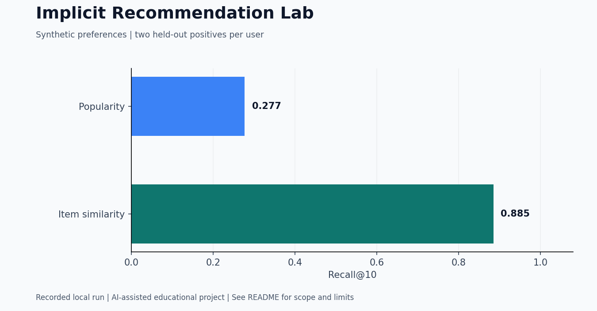

# Implicit Recommendation Lab

Compare item popularity and item-to-item co-occurrence with deterministic user-level held-out positives.

A small educational project prepared with AI assistance for Moustafa Zaalouk's portfolio. This is new demonstration code, not a claim about past employment, research, clients or production deployment. It does not reuse another person's project under a different name.

## Run it

Use Python 3.10 or newer. The recorded local run used Python 3.10.12. A virtual environment is recommended.

```bash
python -m venv .venv
source .venv/bin/activate
pip install -r requirements.txt
python demo.py
python -m unittest -v
```

On Windows use `.venv\Scripts\activate` instead. The first command runs the full experiment and writes `results.json`. The second runs four checks. No API keys, paid services or internet data downloads are needed after dependency installation.

## Recorded results



These values are generated from `results.json`, not estimated or copied. Rerun the code to check them. Minor numerical differences may occur across platforms. Full per-example or per-fold details, where applicable, are in the JSON file.

| Measure | Local result |
| --- | ---: |
| Heldout positives per user | 2 |
| Items | 80 |
| Item kNN: catalog coverage | 0.975000 |
| Item kNN: NDCG at 10 | 0.730030 |
| Item kNN: recall at 10 | 0.885417 |
| Popularity: catalog coverage | 0.212500 |
| Popularity: NDCG at 10 | 0.150456 |
| Popularity: recall at 10 | 0.277083 |
| Seed | 42 |
| Split seed | 43 |
| Train positives per user | 10 |
| Users | 240 |

`verification.txt` records the local test run. The included GitHub Actions workflow is a reproducible check, not a claim that remote CI has already passed.

## How to read the code

1. `demo.py`: data construction/loading, split, model, evaluation and output.
2. `test_demo.py`: output consistency and three experiment-specific checks.
3. `results.json`: the actual captured local results.
4. `requirements.txt`: exact versions used locally.

## Publishing and CI

The initial source is stored as a checksummed ZIP inside the workflow so GitHub can restore exact filenames and the chart without a manual multi-file upload. On its first run it unpacks this original AI-assisted source, tests it, runs the experiment and commits the initialized files as `github-actions[bot]`. Later runs test the actual checked-out source; they do not overwrite it from the bundle. This automation history is not a claim of manual authorship or review.

## Data and attribution

Procedurally generated synthetic data. No personal data or external downloads.

The experiment uses NumPy, SciPy and scikit-learn rather than claiming to implement their estimators from scratch. Their licenses and dataset terms remain separate from this repository's MIT license. No upstream code, author name or license was removed.

## What this does not prove

Synthetic implicit preferences, not observed clicks or purchases. Random per-user holdouts are not temporal and have exposure bias. Metrics rank all unseen items and treat held-out positives as relevant; unknown items are not verified negatives. No cold-start or online test.

## شرح بالمصري

الفكرة: نرشح عناصر من تشابهها حسب التفاعل، ونقارن بالأكثر شعبية. بنخبي عنصرين لكل مستخدم من التدريب. كل التفاعلات صناعية، ومفيش ادعاء بزيادة مبيعات.

لما تشرح المشروع: قول مصدر الداتا، اتقسمت إزاي، إيه الـbaseline، بنقيس بإيه، وإيه حدود النتيجة. ما تقولش إنه شغال في production أو نتيجة على داتا حقيقية لو التجربة صناعية.

## Next experiment

Replace the demonstration data with an appropriately licensed dataset, define an independent evaluation protocol before tuning, and report failures as well as successes. Keep private data and credentials out of commits.
